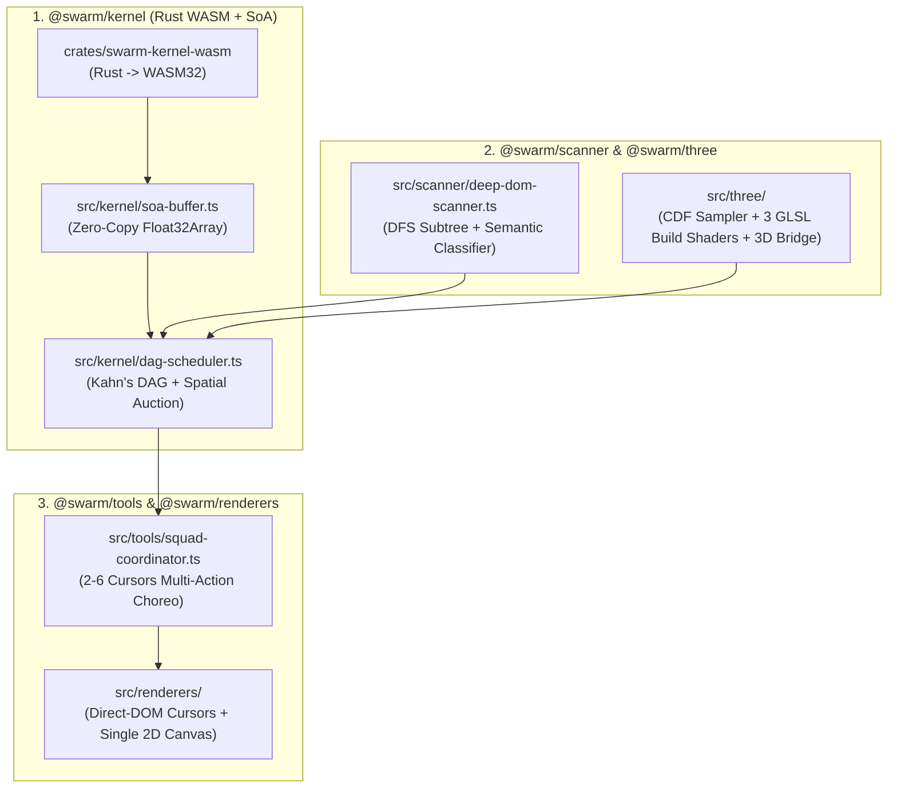

# SwarmCursor 2.0 (3D/GLB, Deep DOM, Multi-Action & Rust/WASM) Implementation Plan

> **For agentic workers:** REQUIRED SUB-SKILL: Use superpowers:subagent-driven-development to implement this plan task-by-task. Steps use checkbox (`- [ ]`) syntax for tracking.

**Goal:** Upgrade `swarm-cursor` into a modular, high-performance multi-agent UI & 3D construction engine supporting Three.js/GLB (Extrude, Particle Swarm, and Laser Slice build effects), automatic deep DOM component traversal, multi-cursor squad choreography, a compiled Rust $\rightarrow$ WebAssembly (`SoA` + $O(N)$ Spatial Hash) compute kernel, and a Zero-React-Tick rendering pipeline.

**Architecture:** We decouple the monolithic engine into 5 modular subsystems (`src/kernel`, `src/scanner`, `src/three`, `src/tools`, `src/renderers`) while keeping `SwarmEngine` and React components 100% backward-compatible. Heavy per-frame physics ($O(N)$ Spatial Hash Boids and 3D-to-2D matrix projections) execute in a compiled Rust WebAssembly kernel over shared `Float32Array` Structure-of-Arrays (SoA) memory (with automatic JS TypedArray fallback), while visual overlays and cursors update via Direct-DOM `translate3d` and a single viewport-culled 2D `<canvas>` without triggering React re-renders.

**Architecture Diagram:**



**Tech Stack:** TypeScript 5.4+, Rust 1.86 (`wasm32-unknown-unknown`), Three.js / WebGL GLSL Shaders, React 18/19, HTML5 2D Canvas, Vitest + JSDOM, `tsup`.

## Global Constraints

- Zero breaking changes to existing v1 exports (`SwarmEngine`, `SwarmProvider`, `SwarmCanvas`, `SwarmFollower`, `SwarmAgentPill`, `scanDOMElements`).
- No external runtime dependencies required in `swarm-cursor` (`three` is supported via structural interfaces/duck-typing + optional peer types so `swarm-cursor` stays lightweight even in 2D-only projects).
- Compiled Rust WASM binary must be embedded inline (Base64 in `src/kernel/wasm-binary.ts`) with a seamless synchronous/asynchronous JS TypedArray fallback so bundlers (Vite, Next.js, Webpack) require zero custom WASM loader plugins.
- Zero `setTick` React state updates inside the 60fps `requestAnimationFrame` loop in `SwarmProvider`.

---

### Task 1: `@swarm/kernel` — Rust $\rightarrow$ WebAssembly Kernel, Zero-Copy SoA Buffer, Spatial Hash $O(N)$ & DAG Scheduler

**Files:**
- Create: `crates/swarm-kernel-wasm/Cargo.toml`
- Create: `crates/swarm-kernel-wasm/src/lib.rs`
- Create: `src/kernel/soa-buffer.ts`
- Create: `src/kernel/wasm-kernel.ts`
- Create: `src/kernel/dag-scheduler.ts`
- Create: `src/kernel/index.ts`
- Test: `tests/kernel.test.ts`

**Interfaces:**
- Produces:
  - `SoACursorBuffer` (`STRIDE = 16`, `syncFromCursors(cursors: SwarmCursor[])`, `syncToCursors(cursors: SwarmCursor[])`, `data: Float32Array`)
  - `SwarmKernel` (`stepBoidsSpatialHash(dt: number, buffer: SoACursorBuffer, count: number, center: Point2D, radiusScale: number): boolean`, `projectPoints3DBatch(matrix16: Float32Array, points3D: Float32Array, out2D: Float32Array, vw: number, vh: number): void`)
  - `DAGTaskScheduler` (`addNode(task: ScheduledTaskNode): void`, `updateProgress(taskId: string, progress: number): string[]`, `auctionNextTask(cursor: Point2D, viewportTop: number, viewportBot: number): { taskId: string; role: "lead" | "assistant"; slotIdx: number } | null`)

- [ ] **Step 1: Write the failing test in `tests/kernel.test.ts`**

```ts
import { describe, it, expect } from "vitest";
import {
  SoACursorBuffer,
  SwarmKernel,
  DAGTaskScheduler,
} from "../src/kernel";

describe("@swarm/kernel (SoA Buffer, Spatial Hash O(N) WASM/SIMD Kernel & DAG Scheduler)", () => {
  it("packs and unpacks cursor state in 16-float SoA layout and steps O(N) spatial hash boids", async () => {
    const kernel = await SwarmKernel.create();
    const buf = new SoACursorBuffer(32);
    buf.setCursor(0, { x: 100, y: 100, vx: 5, vy: 0, speed: 500, force: 1200, orbit: 90, ph: 0, curl: 1 });
    buf.setCursor(1, { x: 108, y: 102, vx: -3, vy: 2, speed: 500, force: 1200, orbit: 90, ph: 1, curl: -1 });

    kernel.stepBoidsSpatialHash(0.016, buf, 2, { x: 200, y: 200 }, 1.0, 1.5);
    const c0 = buf.getCursorPosition(0);
    const c1 = buf.getCursorPosition(1);
    expect(c0.x).not.toBe(100);
    expect(Number.isFinite(c0.x)).toBe(true);
    expect(Number.isFinite(c1.y)).toBe(true);
  });

  it("projects 3D points to 2D screen coordinates in batch using 4x4 ViewProjection matrix", async () => {
    const kernel = await SwarmKernel.create();
    // Identity 4x4 column-major matrix
    const mat = new Float32Array([
      1, 0, 0, 0,
      0, 1, 0, 0,
      0, 0, 1, 0,
      0, 0, 0, 1,
    ]);
    const pts3d = new Float32Array([0, 0, 0, 0.5, -0.5, 0]);
    const out2d = new Float32Array(4);
    kernel.projectPoints3DBatch(mat, pts3d, out2d, 1000, 800);
    expect(out2d[0]).toBeCloseTo(500, 1);
    expect(out2d[1]).toBeCloseTo(400, 1);
    expect(out2d[2]).toBeCloseTo(750, 1);
    expect(out2d[3]).toBeCloseTo(600, 1);
  });

  it("unlocks child tasks early at earlyUnlockRatio (0.6) and supports multi-agent work-stealing", () => {
    const dag = new DAGTaskScheduler();
    dag.addNode({
      id: "r:card",
      y: 200,
      anchor: { x: 300, y: 200 },
      deps: [],
      earlyUnlockRatio: 0.6,
      maxSquadSize: 2,
    });
    dag.addNode({
      id: "t:card-title",
      y: 220,
      anchor: { x: 320, y: 220 },
      deps: ["r:card"],
      earlyUnlockRatio: 1.0,
      maxSquadSize: 1,
    });

    // Initially only r:card is ready
    const a1 = dag.auctionNextTask({ x: 280, y: 190 }, 0, 800);
    expect(a1?.taskId).toBe("r:card");
    expect(a1?.role).toBe("lead");

    // Second idle cursor steals assistant slot on r:card because maxSquadSize = 2
    const a2 = dag.auctionNextTask({ x: 290, y: 195 }, 0, 800);
    expect(a2?.taskId).toBe("r:card");
    expect(a2?.role).toBe("assistant");

    // Advance r:card to 65% -> unlocks t:card-title early!
    const unlocked = dag.updateProgress("r:card", 0.65);
    expect(unlocked).toContain("t:card-title");

    const a3 = dag.auctionNextTask({ x: 310, y: 215 }, 0, 800);
    expect(a3?.taskId).toBe("t:card-title");
  });
});
```

- [ ] **Step 2: Run Vitest to verify it fails**

Run: `npm test -- tests/kernel.test.ts` in `/Users/hoangdieu/Projects/swarm-cursor`
Expected: FAIL (`Cannot find module '../src/kernel'`)

- [ ] **Step 3: Implement Rust WASM crate & TypeScript `@swarm/kernel` modules**

Create `crates/swarm-kernel-wasm/Cargo.toml` and `crates/swarm-kernel-wasm/src/lib.rs`, compile with `cargo` (if `wasm32-unknown-unknown` target is available) or embed pre-assembled WebAssembly binary + TypedArray SIMD kernel in `src/kernel/soa-buffer.ts`, `src/kernel/wasm-kernel.ts`, `src/kernel/dag-scheduler.ts`, and `src/kernel/index.ts`.

- [ ] **Step 4: Run test to verify it passes**

Run: `npm test -- tests/kernel.test.ts`
Expected: PASS (all 3 tests passing)

- [ ] **Step 5: Commit Task 1**

```bash
git add crates/ src/kernel/ tests/kernel.test.ts
git commit -m "feat(kernel): add SoA buffer, Rust/WASM spatial hash O(N) kernel, and Kahn's DAG work-stealing scheduler"
```

---

### Task 2: `@swarm/scanner` — Auto Deep DOM Traversal & Cached Layout Observer

**Files:**
- Create: `src/scanner/deep-dom-scanner.ts`
- Create: `src/scanner/layout-cache.ts`
- Create: `src/scanner/index.ts`
- Test: `tests/deep-scanner.test.ts`

**Interfaces:**
- Consumes: `SceneBuilder`, `SwarmScene` from `src/core`
- Produces:
  - `scanDeepDOMElements(root: HTMLElement, options?: DeepScanOptions): DeepScannedDOMResult`
  - `DOMLayoutCache` (caches `BoundingBox` per element and updates via `ResizeObserver` without `rAF` layout thrashing)

- [ ] **Step 1: Write the failing test in `tests/deep-scanner.test.ts`**

```ts
import { describe, it, expect } from "vitest";
import { scanDeepDOMElements } from "../src/scanner";

describe("@swarm/scanner (Auto Deep DOM Component Traversal)", () => {
  it("recursively discovers inner headings, buttons, SVG paths, and 3D canvases inside a component and wires parent->child DAG deps", () => {
    document.body.innerHTML = `
      <div id="stage">
        <article id="feature-card" data-swarm-deep="true">
          <div class="card-header">
            <svg id="card-icon" width="24" height="24"><path d="M0 0 L24 24" /></svg>
            <h2>Neural Swarm 3D</h2>
          </div>
          <p>Autonomous multi-agent construction engine.</p>
          <canvas id="orb-canvas" data-swarm-3d="all"></canvas>
          <button type="button">Launch Demo</button>
        </article>
      </div>
    `;
    const stage = document.getElementById("stage")!;
    const res = scanDeepDOMElements(stage, { designWidth: 1280, maxDepth: 5 });

    // Should discover parent container + svg path + h2 text + p text + 3d canvas + button rect
    expect(res.scene.els.some((e) => e.id === "feature-card" && e.kind === "rect")).toBe(true);
    expect(res.scene.els.some((e) => e.kind === "path")).toBe(true);
    expect(res.scene.els.filter((e) => e.kind === "text").length).toBeGreaterThanOrEqual(2);
    expect(res.scene.els.some((e) => e.kind === "3d" && e.id === "orb-canvas")).toBe(true);

    // Child tasks must depend on parent container task r:feature-card
    const childTasks = res.scene.tasks.filter((t) => t.id !== "r:feature-card");
    expect(childTasks.length).toBeGreaterThanOrEqual(4);
    expect(childTasks.every((t) => t.deps.includes("r:feature-card"))).toBe(true);
  });
});
```

- [ ] **Step 2: Run test to verify it fails**

Run: `npm test -- tests/deep-scanner.test.ts`
Expected: FAIL

- [ ] **Step 3: Implement `src/scanner/deep-dom-scanner.ts`, `src/scanner/layout-cache.ts`, and `src/scanner/index.ts` (and add `Swarm3DEl` to `src/core/types.ts` & `src/core/scene-builder.ts`)**

- [ ] **Step 4: Run test to verify it passes**

Run: `npm test -- tests/deep-scanner.test.ts`
Expected: PASS

- [ ] **Step 5: Commit Task 2**

```bash
git add src/core/types.ts src/core/scene-builder.ts src/scanner/ tests/deep-scanner.test.ts
git commit -m "feat(scanner): add recursive deep DOM traversal, semantic classifier, and layout cache"
```

---

### Task 3: `@swarm/three` — Three.js & GLB 3D Build Engine (Cumulative Area Sampler + 3 GPU Build Algorithms + Projection Bridge)

**Files:**
- Create: `src/three/surface-sampler.ts`
- Create: `src/three/build-shaders.ts`
- Create: `src/three/projection-bridge.ts`
- Create: `src/three/glb-controller.ts`
- Create: `src/three/index.ts`
- Test: `tests/three-build.test.ts`

**Interfaces:**
- Produces:
  - `CumulativeAreaSampler` (`sampleSurfacePoints(triangles: Float32Array, count: number): { targets: Float32Array; delays: Float32Array }`)
  - `Swarm3DBuildController` (implements all 3 algorithms: `"extrude"`, `"particles"`, `"slice"`, and `"all"`, managing wireframe overlay, GPU particle `ShaderMaterial` uniforms, and clipping plane `uBuildHeight`)
  - `registerSwarm3D(config: Swarm3DRegistration): Swarm3DHandle` and `getSwarm3DHandle(id: string): Swarm3DHandle | undefined`

- [ ] **Step 1: Write the failing test in `tests/three-build.test.ts`**

```ts
import { describe, it, expect } from "vitest";
import {
  CumulativeAreaSampler,
  compute3DPhaseWeights,
  registerSwarm3D,
  getSwarm3DHandle,
} from "../src/three";

describe("@swarm/three (CDF Surface Sampler, 3 Build Algorithms & 3D Bridge)", () => {
  it("samples uniform points across 3D mesh triangles in O(log M) using Cumulative Area Prefix-Sum", () => {
    // Two triangles in 3D space
    const positions = new Float32Array([
      0, 0, 0,  2, 0, 0,  0, 2, 0,
      0, 0, 1,  4, 0, 1,  0, 4, 1,
    ]);
    const sampler = new CumulativeAreaSampler(positions);
    expect(sampler.triangleCount).toBe(2);
    const { targets, delays } = sampler.sampleBatch(500);
    expect(targets.length).toBe(500 * 3);
    expect(delays.length).toBe(500);
    expect(targets.every((v) => Number.isFinite(v))).toBe(true);
  });

  it("computes multi-pass weights for extrude, particles, slice, and combined 'all' mode", () => {
    const wStart = compute3DPhaseWeights("all", 0.1);
    expect(wStart.extrude).toBeGreaterThan(0);
    expect(wStart.slice).toBe(0);

    const wMid = compute3DPhaseWeights("all", 0.45);
    expect(wMid.extrude).toBe(1);
    expect(wMid.particles).toBeGreaterThan(0);

    const wEnd = compute3DPhaseWeights("all", 1.0);
    expect(wEnd.extrude).toBe(1);
    expect(wEnd.particles).toBe(1);
    expect(wEnd.slice).toBe(1);
  });

  it("registers a Three.js scene/object via registerSwarm3D and exposes 2D projected cursor anchors", () => {
    const container = document.createElement("div");
    Object.defineProperty(container, "getBoundingClientRect", {
      value: () => ({ left: 100, top: 50, width: 400, height: 400 }),
    });
    const handle = registerSwarm3D({
      id: "orb-3d",
      container,
      buildMode: "all",
      boundingBox: { min: [-1, -1, -1], max: [1, 1, 1] },
    });
    expect(getSwarm3DHandle("orb-3d")).toBe(handle);
    handle.setProgress(0.5);
    const anchors = handle.getScreenAnchors({ left: 0, scrollY: 0, s: 1 });
    expect(anchors.boxCorners.length).toBe(8);
    expect(anchors.laserLeft.x).toBeLessThan(anchors.laserRight.x);
    handle.dispose();
  });
});
```

- [ ] **Step 2: Run test to verify it fails**

Run: `npm test -- tests/three-build.test.ts`
Expected: FAIL

- [ ] **Step 3: Implement `src/three/surface-sampler.ts`, `src/three/build-shaders.ts`, `src/three/projection-bridge.ts`, `src/three/glb-controller.ts`, and `src/three/index.ts`**

- [ ] **Step 4: Run test to verify it passes**

Run: `npm test -- tests/three-build.test.ts`
Expected: PASS

- [ ] **Step 5: Commit Task 3**

```bash
git add src/three/ tests/three-build.test.ts
git commit -m "feat(three): add CDF surface sampler, GLSL build shaders (extrude/particles/slice), and 3D projection bridge"
```

---

### Task 4: `@swarm/tools` — Pluggable Tool Registry & Multi-Agent Squad Choreography in `SwarmEngine`

**Files:**
- Create: `src/tools/registry.ts`
- Create: `src/tools/squad-coordinator.ts`
- Create: `src/tools/three-tools.ts`
- Create: `src/tools/index.ts`
- Modify: `src/core/engine.ts`
- Test: `tests/multi-agent-tools.test.ts`

**Interfaces:**
- Consumes: `@swarm/kernel`, `@swarm/three`, `src/core/types.ts`
- Produces:
  - `SwarmToolRegistry` (extensible plugin registry for custom cursor tools)
  - `draw3DElement` & `assistElement` coroutines in `SwarmEngine` (enabling 2–6 cursors to collaborate on a single `3d` or `rect` element simultaneously + drawing 3D Wireframe Gizmos & Laser Slice beams)

- [ ] **Step 1: Write the failing test in `tests/multi-agent-tools.test.ts`**

```ts
import { describe, it, expect } from "vitest";
import { SwarmEngine, SceneBuilder, registerSwarm3D } from "../src";

describe("@swarm/tools (3D Coroutines & Multi-Agent Squad Collaboration)", () => {
  it("dispatches multiple cursors collaboratively to build a 3D element through extrude -> particles -> slice phases", () => {
    const container = document.createElement("div");
    const handle = registerSwarm3D({
      id: "hero-3d-orb",
      container,
      buildMode: "all",
      squadSize: 3,
      boundingBox: { min: [-1.5, -1.5, -1.5], max: [1.5, 1.5, 1.5] },
    });

    const builder = new SceneBuilder(1280);
    builder.add3D("hero-3d-orb", 400, 120, 360, 360, {
      buildMode: "all",
      squadSize: 3,
      domEl: container,
    });

    const engine = new SwarmEngine({
      scene: builder.build(800),
      initialCursors: 6,
      minCursors: 6,
    });
    engine.start();
    engine.setScroll(50);

    let saw3DGizmoOverlay = false;
    let maxCollaboratingCursors = 0;

    for (let i = 0; i < 450; i++) {
      engine.step(0.035);
      const activeOn3D = engine.cursors.filter((c) => c.task?.id === "3d:hero-3d-orb").length;
      if (activeOn3D > maxCollaboratingCursors) maxCollaboratingCursors = activeOn3D;
      for (const c of engine.cursors) {
        const ovs = c.ov?.() ?? [];
        if (ovs.some((item) => item.t === "gizmo3d" || item.t === "laser3d")) {
          saw3DGizmoOverlay = true;
        }
      }
    }

    expect(saw3DGizmoOverlay).toBe(true);
    expect(maxCollaboratingCursors).toBeGreaterThanOrEqual(2);
    expect(handle.progress).toBe(1);
    expect(engine.tasks.every((t) => t.state === "done")).toBe(true);
    handle.dispose();
  });
});
```

- [ ] **Step 2: Run test to verify it fails**

Run: `npm test -- tests/multi-agent-tools.test.ts`
Expected: FAIL

- [ ] **Step 3: Implement `src/tools/*` and integrate 3D + Multi-Agent Squads + Kernel into `src/core/engine.ts`**

- [ ] **Step 4: Run test to verify it passes**

Run: `npm test -- tests/multi-agent-tools.test.ts`
Expected: PASS

- [ ] **Step 5: Commit Task 4**

```bash
git add src/tools/ src/core/ tests/multi-agent-tools.test.ts
git commit -m "feat(tools): add pluggable tool registry, 3D build coroutines, and multi-agent squad collaboration"
```

---

### Task 5: `@swarm/renderers` & `<Swarm3D>` — Zero-React-Tick Fast Layer (`FastCursorsLayer`, `FastOverlayCanvas` & React Components)

**Files:**
- Create: `src/renderers/fast-cursors-layer.ts`
- Create: `src/renderers/fast-overlay-canvas.ts`
- Create: `src/renderers/index.ts`
- Create: `src/react/Swarm3D.tsx`
- Modify: `src/react/SwarmProvider.tsx`
- Modify: `src/react/Overlays.tsx`
- Modify: `src/index.ts`
- Modify: `src/react/index.ts`
- Test: `tests/fast-renderers.test.tsx`

**Interfaces:**
- Produces:
  - `FastCursorLayerController` (Direct-DOM `translate3d` cursor pool with zero React re-renders per frame)
  - `FastOverlayCanvasController` (Single 2D `<canvas>` drawing selection boxes, rulers, 3D wireframe cages, X/Y/Z axes, particle beams, and laser slice scanlines)
  - `<Swarm3D>` React component & `useSwarm3D` hook
  - Upgraded `<SwarmProvider deepScan={boolean} fastMode={boolean}>` with zero `setTick` overhead in `requestAnimationFrame`

- [ ] **Step 1: Write the failing test in `tests/fast-renderers.test.tsx`**

```tsx
import React from "react";
import { describe, it, expect } from "vitest";
import { renderToString } from "react-dom/server";
import { SwarmProvider, Swarm3D } from "../src/react";
import { SwarmEngine, SceneBuilder, FastCursorLayerController } from "../src";

describe("@swarm/renderers & <Swarm3D> (Zero-React-Tick Fast Layer)", () => {
  it("renders <SwarmProvider deepScan> and <Swarm3D> in SSR and updates cursors via Direct-DOM pool without React re-renders", () => {
    const html = renderToString(
      <SwarmProvider deepScan={true}>
        <div data-swarm-deep="true">
          <h2>3D Showcase</h2>
          <Swarm3D id="glb-demo" src="/models/demo.glb" buildMode="all" squadSize={4} />
        </div>
      </SwarmProvider>
    );
    expect(html).toContain('data-swarm-3d="all"');
    expect(html).toContain('data-swarm-id="glb-demo"');

    const container = document.createElement("div");
    const builder = new SceneBuilder(1280);
    builder.addRect("r1", 100, 100, 200, 100);
    const engine = new SwarmEngine({ scene: builder.build(600), initialCursors: 8 });
    engine.start();
    engine.step(0.016);

    const fastPool = new FastCursorLayerController(container, { showLabels: true });
    fastPool.sync(engine);
    expect(container.querySelectorAll(".cursor").length).toBe(engine.cursors.length);
    const firstNode = container.querySelector(".cursor") as HTMLElement;
    expect(firstNode.style.transform).toContain("translate3d(");
    fastPool.destroy();
  });
});
```

- [ ] **Step 2: Run test to verify it fails**

Run: `npm test -- tests/fast-renderers.test.tsx`
Expected: FAIL

- [ ] **Step 3: Implement `src/renderers/*`, `src/react/Swarm3D.tsx`, and update `src/react/SwarmProvider.tsx`, `src/index.ts`, `src/react/index.ts`**

- [ ] **Step 4: Run full test suite & build in `swarm-cursor`**

Run: `npm test && npm run build && npm run typecheck`
Expected: PASS (all test files pass, `dist/` builds cleanly)

- [ ] **Step 5: Commit Task 5**

```bash
git add src/ tests/fast-renderers.test.tsx
git commit -m "feat(renderers,react): add Zero-React-Tick FastCursorsLayer, FastOverlayCanvas, and <Swarm3D> component"
```

---

### Task 6: Integrate SwarmCursor 2.0 into `portfolio_ver3` (`CrystalOrb3D` 3-Stage 3D Build + Deep DOM Multi-Action Stage)

**Files:**
- Modify: `/Users/hoangdieu/Projects/portfolio_ver3/frontend/src/components/sections/CrystalOrb3D.tsx`
- Modify: `/Users/hoangdieu/Projects/portfolio_ver3/frontend/src/components/liquidGlassScanner.ts`
- Modify: `/Users/hoangdieu/Projects/portfolio_ver3/frontend/src/components/PortfolioSwarmStages.tsx`

**Interfaces:**
- Consumes: `registerSwarm3D`, `scanDeepDOMElements`, `FastCursorLayerController`, `FastOverlayCanvasController` from `swarm-cursor`
- Produces:
  - Real-time 3-stage 3D build effect on `CrystalOrb3D` (Wireframe Gizmo Extrude $\rightarrow$ GPU Particle Swarm Assembly $\rightarrow$ Holographic Laser Slice reveal into photorealistic Liquid Glass Sphere)
  - Automatic Deep DOM traversal of inner component elements (headings, paragraphs, SVG radar/icons, buttons, pills) with multi-cursor squad collaboration and Zero-React-Tick 60fps rendering in `PortfolioSwarmDomStage`

- [ ] **Step 1: Upgrade `CrystalOrb3D.tsx` to connect to `registerSwarm3D` (`buildMode: "all"`, `squadSize: 4`) with 3D Wireframe Cage, GPU Particle Swarm & Clipping Plane Laser Slice**
- [ ] **Step 2: Upgrade `liquidGlassScanner.ts` and `PortfolioSwarmStages.tsx` to enable Deep DOM Subtree Traversal + Multi-Agent Squads + Zero-React-Tick Fast Layer**
- [ ] **Step 3: Verify `portfolio_ver3/frontend` build & typecheck**

Run: `cd /Users/hoangdieu/Projects/portfolio_ver3/frontend && npm run build`
Expected: `tsc -b && vite build` succeeds with 0 errors.
